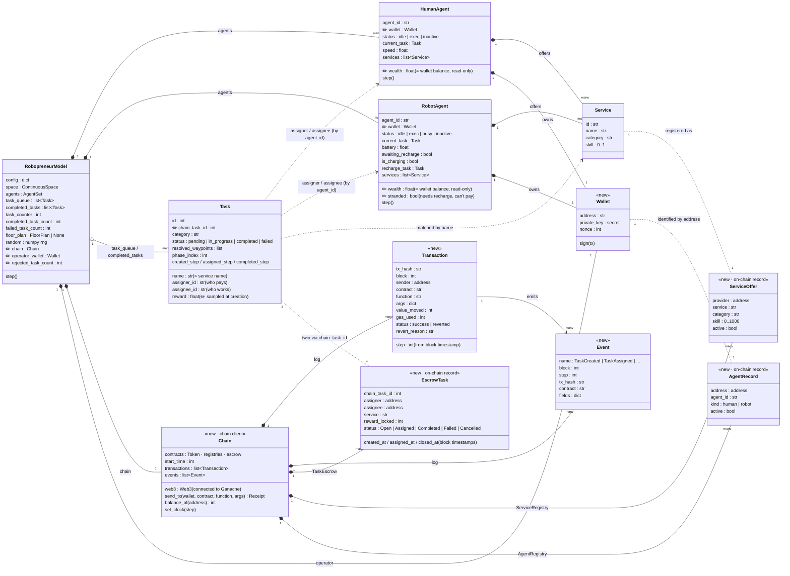

# Architecture — with blockchain & web3

Copy of [architecture-diagram.md](architecture-diagram.md) with the blockchain layer added.
What each piece does and why: [blockchain-functionalities.md](blockchain-functionalities.md).

**Legend**
- 🟨 gold boxes = **new** blockchain modules and smart contracts
- dashed thick border + ✏️ = **existing** module that **changes**
- plain boxes = unchanged
- the blockchain is **always on** — there is no switch to disable it

## 1 · Module map

```mermaid
flowchart TD

  %% ── colour palette (same as flow-diagram.md) ────────────────────
  classDef entry   fill:#1e3a5f,stroke:#3b82f6,color:#bfdbfe
  classDef core    fill:#1a2e1a,stroke:#22c55e,color:#bbf7d0
  classDef agent   fill:#3f2c1c,stroke:#fb923c,color:#fed7aa
  classDef task    fill:#2d1f4e,stroke:#a855f7,color:#e9d5ff
  classDef economy fill:#1f2e1f,stroke:#4ade80,color:#dcfce7
  classDef util    fill:#252525,stroke:#94a3b8,color:#e2e8f0
  classDef data    fill:#2a2a1e,stroke:#eab308,color:#fef9c3
  classDef ext     fill:#1a1a2e,stroke:#818cf8,color:#c7d2fe
  %% ── new: blockchain ─────────────────────────────────────────────
  classDef chain    fill:#3d3000,stroke:#facc15,color:#fef08a,stroke-width:2px
  classDef contract fill:#4a3500,stroke:#f59e0b,color:#fde68a,stroke-width:2px
  classDef chainext fill:#2e2400,stroke:#ca8a04,color:#fef9c3
  %% ── marks an existing module that changes ───────────────────────
  classDef changed  stroke-width:3px,stroke-dasharray:6 4

  %% ═══════════════════════════════════════════════════════════════
  %% ENTRY POINTS — how a human starts a run
  %% ═══════════════════════════════════════════════════════════════
  subgraph ENTRY["🚪  entry points"]
    direction LR
    APP["✏️ app.py\nsolara dashboard\n(interactive)\n+ live event feed · balances"]:::entry
    RUN["✏️ scripts/run_experiment.py\nheadless run → csv\n+ transactions.csv · events.csv"]:::entry
    FULL["scripts/run_full_experiment.py\nrun + plot"]:::entry
    VAL["✏️ scripts/validate_config.py\nchecks a config.yaml\n+ blockchain section"]:::entry
    PLOT["scripts/plot_*.py\nscripts/compare_scenarios.py\nread csv → png"]:::entry
  end

  %% ═══════════════════════════════════════════════════════════════
  %% CONFIG
  %% ═══════════════════════════════════════════════════════════════
  subgraph CONFIG["⚙️  configuration"]
    direction LR
    YAML[("✏️ config.yaml\nexperiments/**/config.yaml\n+ blockchain: ganache_cmd · port · gas_eth_per_agent")]:::data
    LOAD["config/load_config.py\nyaml → dict"]:::util
  end

  %% ═══════════════════════════════════════════════════════════════
  %% CORE MODEL
  %% ═══════════════════════════════════════════════════════════════
  subgraph CORE["🧠  core  —  core/model.py"]
    MODEL["✏️ RobopreneurModel (mesa.Model)\nowns: space · agents · task_queue\ncompleted_tasks · datacollector · rng\n+ ganache process · chain · operator wallet\n+ chain clock = step × 60 s"]:::core
  end

  %% ═══════════════════════════════════════════════════════════════
  %% BEHAVIOUR
  %% ═══════════════════════════════════════════════════════════════
  subgraph BEHAVIOUR["🤖  agents & behaviour"]
    direction TB
    AGENTS["✏️ behaviour/agents.py\nHumanAgent · RobotAgent\nmove · execute task phases · finish task\n+ wallet per agent · wealth = balance"]:::agent
    BATT["✏️ behaviour/battery.py\ndrain / recharge\ncreates BatteryCharging tasks\n+ pays via escrow · retry if broke"]:::agent
    SCHED["behaviour/schedule.py\nactive hours · day / minute clock"]:::agent
  end

  subgraph TASKS["📋  tasks"]
    direction TB
    TA["✏️ tasks/task_assignation.py\ngenerate_tasks · assign_tasks\n+ reward sampled at creation"]:::task
    TASKPY["✏️ tasks/tasks.py\nTask class · requeue_task\n+ chain_task_id"]:::task
    SERV["tasks/services.py\nService class\n(name · category · skill)"]:::task
  end

  subgraph ECON["💰  economy"]
    ECO["✏️ economy/economy.py\nsettle_task (replaces transfer_reward)\nsuccess → completeTask · failure → failTask"]:::economy
  end

  %% ═══════════════════════════════════════════════════════════════
  %% WORLD + HELPERS
  %% ═══════════════════════════════════════════════════════════════
  subgraph WORLD["🗺️  world & helpers"]
    direction LR
    FP["world/floor_plan.py\npolygon world · path routing"]:::util
    MOV["world/movement.py\ncheck_if_at_location"]:::util
    UTIL["world/utils.py\nsample reward / duration\nresolve waypoints"]:::util
    MET["✏️ world/metrics.py\ngini · throughput · wealth\nqueue size · critical battery\n+ escrow locked · rejected tasks\n+ stranded robots · tx count · gas"]:::util
  end

  %% ═══════════════════════════════════════════════════════════════
  %% NEW · BLOCKCHAIN LAYER
  %% ═══════════════════════════════════════════════════════════════
  subgraph BLOCKCHAIN["⛓️  NEW · blockchain layer  —  blockchain/"]
    direction TB
    GANPY["ganache.py\nstart a fresh Ganache per run\nseed · fixed start time · stop at end"]:::chain
    WALLET["wallet.py\nWallet: address · private key · nonce\nsigns transactions · IEC + test ETH"]:::chain
    CHAIN["chain.py  —  chain client\nweb3.py · compile & deploy contracts\nsend_tx · balance_of · set_clock\nreverts → python errors · tx & event log"]:::chain

    subgraph GANACHE["⛓️  Ganache  —  local Ethereum blockchain (Node.js process)"]
      subgraph CONTRACTS["📜  smart contracts  —  blockchain/contracts/*.sol (Solidity)"]
        direction LR
        TOKEN["IECToken\nERC-20 (OpenZeppelin)\nmint · transfer · balanceOf"]:::contract
        AREG["AgentRegistry\nregisterAgent · isRegistered"]:::contract
        SREG["ServiceRegistry\nregisterService · getProviders"]:::contract
        ESCROW["TaskEscrow\ncreateTask · assignTask · requeueTask\ncompleteTask · failTask · cancelTask"]:::contract
      end
    end
  end

  %% ═══════════════════════════════════════════════════════════════
  %% EXTERNAL LIBS
  %% ═══════════════════════════════════════════════════════════════
  subgraph EXT["📦  external libraries"]
    direction LR
    MESA["mesa\nagent framework"]:::ext
    SHAPELY["shapely + jupedsim\ngeometry + routing"]:::ext
    SOLARA["solara · matplotlib\npandas · seaborn"]:::ext
    WEB3["NEW · web3.py + eth-account\ntalk to the chain · keys"]:::chainext
    SOLC["NEW · py-solc-x\nSolidity compiler"]:::chainext
    NODE["NEW · Node.js packages\nganache · @openzeppelin/contracts"]:::chainext
  end

  %% ── entry points ────────────────────────────────────────────────
  APP --> LOAD
  APP --> MODEL
  RUN --> LOAD
  RUN --> MODEL
  FULL --> RUN
  FULL --> PLOT
  VAL -.->|reads| YAML
  RUN -.->|writes csv| PLOT
  LOAD -.->|reads| YAML

  %% ── model wiring ────────────────────────────────────────────────
  MODEL -->|creates agents| AGENTS
  MODEL -->|every step| TA
  MODEL -->|world.mode = floor_plan| FP
  MODEL -->|datacollector| MET

  %% ── agents ──────────────────────────────────────────────────────
  AGENTS -->|builds per agent| SERV
  AGENTS -->|robots, every step| BATT
  AGENTS --> SCHED
  AGENTS --> MOV
  AGENTS -->|on task end\nsuccess or failure| ECO
  AGENTS -->|on interruption| TASKPY
  AGENTS -->|path finding| FP

  %% ── tasks ───────────────────────────────────────────────────────
  TA -->|creates| TASKPY
  TA --> UTIL
  TA --> SCHED
  TA -->|isinstance checks| AGENTS

  %% ── battery ─────────────────────────────────────────────────────
  BATT -->|creates recharge task| TASKPY
  BATT --> UTIL
  BATT --> MOV

  %% ── helpers ─────────────────────────────────────────────────────
  UTIL -->|random points| FP

  %% ── external ────────────────────────────────────────────────────
  MODEL -.-> MESA
  AGENTS -.-> MESA
  FP -.-> SHAPELY
  APP -.-> SOLARA
  PLOT -.-> SOLARA

  %% ══ NEW · blockchain wiring ═════════════════════════════════════
  MODEL ==>|init: start Ganache| GANPY
  MODEL ==>|init: deploy contracts · mint\nevery step: set clock = step × 60 s| CHAIN
  AGENTS ==>|owns one| WALLET
  AGENTS ==>|init: registerAgent · registerService\ninterruption: requeueTask| CHAIN
  ECO ==>|completeTask / failTask| CHAIN
  TA ==>|createTask · assignTask\ngetProviders| CHAIN
  BATT ==>|createTask BatteryCharging\nrequeueTask| CHAIN
  WALLET ==>|signs every tx| CHAIN
  MET ==>|balances · escrow · tx log| CHAIN
  RUN ==>|tx log · event log| CHAIN
  APP ==>|event feed| CHAIN

  GANPY ==>|launches| GANACHE
  CHAIN ==>|JSON-RPC · calls deployed contracts| CONTRACTS
  ESCROW -->|locks / releases IEC| TOKEN
  ESCROW -->|checks member| AREG
  ESCROW -->|checks service offer| SREG
  SREG -->|checks member| AREG

  CHAIN -.-> WEB3
  CHAIN -.-> SOLC
  WALLET -.-> WEB3
  GANPY -.-> NODE

  %% ── mark changed modules ────────────────────────────────────────
  class APP,RUN,VAL,YAML,MODEL,AGENTS,BATT,TA,TASKPY,ECO,MET changed
```

### What the new arrows mean

| Arrow | Meaning |
| --- | --- |
| `core/model.py` ⇒ `ganache.py` | At init the model starts a fresh Ganache process for this run (seeded with the simulation seed, fixed start time) and stops it when the run ends. |
| `core/model.py` ⇒ `chain.py` | At init the model connects to Ganache, takes Ganache's first pre-funded account as its **operator wallet**, compiles and deploys the 4 contracts, sends each agent test ETH for gas and **mints** `initial_wealth` IEC into each agent's wallet. At the start of every `model.step()` it sets Ganache's clock to `start + step × 60 s`. |
| `agents.py` ⇒ `wallet.py` | Each agent owns exactly one wallet. `agent.wealth` is no longer a stored number — it reads `IECToken.balanceOf(wallet.address)`. |
| `agents.py` ⇒ `chain.py` | At init each agent registers itself and its services. If a task is interrupted (schedule or low battery) it sends `requeueTask`. |
| `agents.py` → `economy.py` ⇒ `chain.py` | When a task ends, `_finish_task` calls `economy.settle_task()` (replaces `transfer_reward`), which sends `completeTask` (money → worker) or `failTask` (money → back to assigner). `economy.py` stays the one place that deals with payments. |
| `task_assignation.py` ⇒ `chain.py` | Task generation sends `createTask` (reward locked in escrow; if it reverts the task is dropped and counted as rejected). Assignment sends `assignTask`. |
| `battery.py` ⇒ `chain.py` | The robot pays for its own recharge through `createTask`. If it can't afford it, it retries later (D7). |
| `wallet.py` ⇒ `chain.py` | Every transaction is signed by the sender's wallet — this is how the contract knows *who* is asking. |
| `chain.py` ⇒ Ganache contracts | Every call goes over JSON-RPC (Ethereum's standard request format) to the contracts deployed on Ganache. Ganache mines each transaction instantly, so the result (or the revert reason) comes back right away. |
| `TaskEscrow` → `IECToken` / registries | The escrow is the only contract that moves money between agents, and it checks membership and service offers before accepting an assignment. |
| `metrics.py`, `run_experiment.py`, `app.py` ⇒ `chain.py` | Read-only: balances, escrow totals, transaction and event logs for metrics, CSVs and the dashboard. |

> **Why one chain client in the middle?** It's like a power socket: the simulator plugs
> into it and never deals with web3 details (signing, gas, receipts, decoding events).
> All of that lives in `chain.py`. If we ever replace Ganache (e.g. with Hardhat, Anvil or
> a public testnet), only this module changes.

## 2 · Data model — with blockchain

New classes are tagged `<<new>>`; changed fields are marked ✏️. `wealth` on agents now
comes from the wallet.

### On-chain twins

Three Python objects get an **on-chain twin**. The Python object keeps the physical
details; the twin keeps the economic agreement.

| Python (off-chain) | On-chain twin | Linked by | Twin holds |
| --- | --- | --- | --- |
| `HumanAgent` / `RobotAgent` | `AgentRecord` (AgentRegistry) | wallet address | identity, kind, active |
| `Service` | `ServiceOffer` (ServiceRegistry) | provider address + service name | who offers what, skill |
| `Task` | `EscrowTask` (TaskEscrow) | `chain_task_id` | assigner, assignee, locked reward, status |
