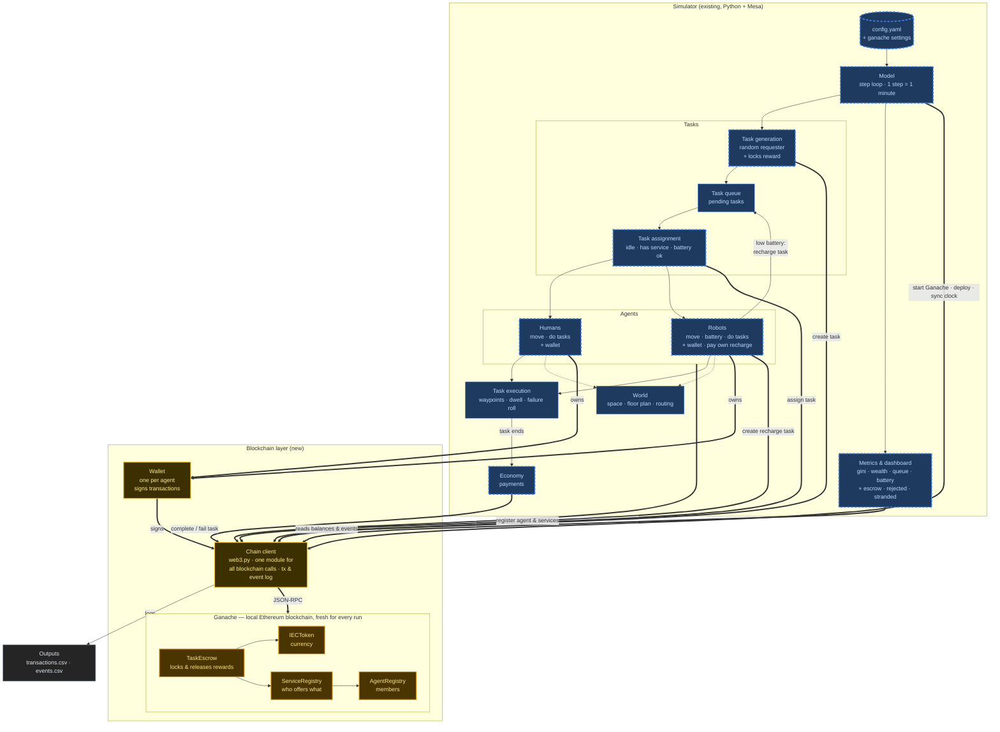

# Blockchain in Robopreneur Sim

## 1. Architecture

Dashed blue = existing modules that get small changes. 
Plain blue = unchanged. 
Gold = new.

1. Wallet (one per agent). Each human and robot gets a blockchain account: a public address, like a bank account number, and a secret key. The wallet signs every request the agent sends. That signature is how the blockchain knows who is asking, and stops one agent from spending another's money.
2. Chain client. A single Python module (built on web3.py, the standard Python library for Ethereum) that does all the talking to the blockchain. The rest of the simulator never deals with blockchain details. It calls simple functions like "create task", and the chain client sends the request, waits for the answer, turns errors such as "not enough money" into something the simulator can react to, and keeps a log of every transaction and event.
Why it matters: if you ever replace Ganache, only this module changes.
3. Ganache, with the four smart contracts inside. Ganache is the blockchain itself, running on your computer and started fresh for each run. Inside it live the four contracts (small programs whose rules can't be changed once installed):
- IECToken: the money. It holds everyone's balances and moves IEC between accounts.
- AgentRegistry: the member list. Only registered agents can take part in the market.
- ServiceRegistry: the "yellow pages" of who offers which service. The arrow to AgentRegistry means it checks the member list before accepting a listing.
- TaskEscrow: the core of the system. It holds each task's reward until the task ends. Its two arrows show it uses IECToken to lock and release money, and checks ServiceRegistry so a task only goes to someone who actually offers that service.

### Smart contract functions

**IECToken** — ERC-20 (OpenZeppelin), 2 decimals so rewards like 140.37 IEC are exact.

| Function | Caller | Does | Event |
| --- | --- | --- | --- |
| `mint(to, amount)` | operator | create IEC in a wallet; only while minting is open | `Transfer` |
| `finishMinting()` | operator | close minting forever → fixed supply | `MintingFinished` |
| `approve(spender, amount)` | agent | let TaskEscrow pull IEC from this wallet *(standard)* | `Approval` |
| `transfer` / `transferFrom` | escrow | move IEC *(standard, used by TaskEscrow)* | `Transfer` |
| `balanceOf(address)` | anyone · view | IEC balance *(standard)* | — |

**AgentRegistry**

| Function | Caller | Does | Event |
| --- | --- | --- | --- |
| `registerAgent(agentId, kind)` | agent | add caller as `human` / `robot`; fails if already registered | `AgentRegistered` |
| `isRegistered(address)` | anyone · view | is this address a member? | — |
| `getAgent(address)` | anyone · view | agentId, kind | — |

**ServiceRegistry** — knows AgentRegistry.

| Function | Caller | Does | Event |
| --- | --- | --- | --- |
| `registerService(name, category, skill)` | agent | publish an offer; caller must be registered, `skill` 0–1000 | `ServiceRegistered` |
| `offers(provider, name)` | anyone · view | does this provider offer this service? | — |
| `getProviders(name)` | anyone · view | all providers of a service | — |

**TaskEscrow** — knows IECToken, both registries and the operator.

| Function | Caller | Rules | Does | Event |
| --- | --- | --- | --- | --- |
| `createTask(service, reward) → taskId` | assigner (agent) | registered · enough IEC | reward: wallet → escrow; status `Open` | `TaskCreated` |
| `assignTask(taskId, assignee)` | operator | `Open` · assignee registered, offers service, ≠ assigner | status `Assigned` | `TaskAssigned` |
| `requeueTask(taskId)` | operator | `Assigned` | back to `Open`, money stays locked | `TaskRequeued` |
| `completeTask(taskId)` | operator | `Assigned` | reward: escrow → assignee; status `Completed` | `TaskCompleted` |
| `failTask(taskId)` | operator | `Assigned` | reward: escrow → assigner; status `Failed` | `TaskFailed` |
| `cancelTask(taskId)` | assigner | `Open` | refund assigner; status `Cancelled` *(not used by the sim yet)* | `TaskCancelled` |
| `getTask(taskId)` | anyone · view | — | assigner, assignee, service, reward, status | — |
| `totalLocked()` | anyone · view | — | IEC currently held in escrow (for metrics) | — |

## 2. Flow and initialization

```mermaid
flowchart LR
  classDef init  fill:#1e3a5f,stroke:#3b82f6,color:#bfdbfe
  classDef chain fill:#3d3000,stroke:#facc15,color:#fef08a,stroke-width:2px
  classDef loop  fill:#1a2e1a,stroke:#22c55e,color:#bbf7d0

  subgraph INIT["Initialization  —  once, at step 0"]
    direction TB
    P1["1 · System & config\nseed · world"]:::init
    P2["2 · Start Ganache & deploy contracts\nToken → AgentRegistry →\nServiceRegistry → TaskEscrow"]:::chain
    P3["3 · Create agents\nhumans · robots"]:::init
    P4["4 · Create wallets\ngas ETH · register ·\nfund 2000 IEC · authorize escrow"]:::chain
    P5["5 · Register services"]:::chain
    P6["6 · Finish setup\nmoney supply fixed"]:::chain
    P1 --> P2 --> P3 --> P4 --> P5 --> P6
  end

  subgraph LOOP["Every step  —  chain clock = step × 60 s"]
    direction TB
    L1["Task created\nrequester locks reward\nin escrow"]:::chain
    L2["Task assigned\nsimulator picks worker"]:::chain
    L3["Task executed\noff-chain: move · dwell"]:::loop
    L4["Task ends\nsuccess → worker paid\nfailure → requester refunded"]:::chain
    L1 --> L2 --> L3 --> L4
  end

  P6 --> L1
```

Startup happens once, at step 0:

1. System and config. Read config.yaml, set the random seed and build the world. Same as today, plus reading the blockchain: settings (Ganache port and start options).
2. Start Ganache and deploy the contracts. The simulator starts a fresh Ganache blockchain for this run (same seed → same accounts every time) and connects to it. Ganache's first account, which comes pre-loaded with test ETH, becomes the simulator's own wallet (the "operator"). Then it installs the four contracts in order: Token → AgentRegistry → ServiceRegistry → TaskEscrow. The order matters because each contract must be told where the contracts it checks live, so those must exist first (foundations before walls before roof). This comes before the agents because you can't open an account at a bank that doesn't exist yet.
3. Create the agents. Same as today: humans and robots placed in the world. At this point they have no money and no market identity.
4. Create the wallets. For each agent:
- (a) generate its wallet from the seed plus its name, so it gets the same address every run;
- (b) receive some test ETH from the operator to pay for gas (the blockchain's transaction fee — separate from IEC, the market's money);
- (c) join the member list;
- (d) receive 2000 IEC;
- (e) authorize the escrow to take payments from it, like setting up a domiciliación bancaria. Without this, a contract can't touch anyone's money.
5. Register services. Each agent publishes what it offers, e.g. "robot_1_0 offers LabCleaning, skill 950". Skill is stored ×1000 because blockchains don't handle decimals. The registry rejects anyone not on the member list, which is why step 4 comes first.
6. Finish setup. The simulator gives up its power to create money, so the economy is fixed at 8000 IEC for the whole run. All 41 setup transactions (default config) are recorded at step 0, and the first metrics snapshot is taken.

Every step:

1. Sync the clock: the simulator sets Ganache's clock to step × 60 seconds, so every transaction in this step carries this step's time.
2. Task created: a random agent requests a service and its reward is moved from its wallet into escrow. If it can't afford it, the request is rejected and counted. A robot with low battery does the same for its own recharge; if it's broke, it becomes "stranded" and tries again later.
3. Agents act: they move and work (normal Python). When a task ends, the economy module tells the escrow to pay the worker or refund the requester. If a task is interrupted, it goes back to the queue on the blockchain too, with its money still locked.
4. Task assigned: the simulator picks a worker and the escrow checks that worker really offers the service.
5. Metrics collected.

---

## 3. Decisions 

| # | Decision | Why |
| --- | --- | --- |
| 4 | **One chain client module** (`chain.py`, on `web3.py`) | All blockchain calls, signing, error handling and logging live in one place. The rest of the simulator calls simple functions like `create_task()`. If we ever move from Ganache to another chain, only this module changes. |
| 5 | **On-chain vs off-chain split** — money, identity, service offers and task agreements on-chain; movement, battery, schedules, execution off-chain | Running physics on-chain would be slow and pointless; this is how real robot/IoT marketplaces split it. |
| 6 | **Four small contracts**: IECToken, AgentRegistry, ServiceRegistry, TaskEscrow | One job each, easy to read and test. |
| 7 | **Escrow:** reward locked at task creation, released on completion, refunded on failure | Every task in the queue is guaranteed to be paid; nobody's balance can go negative (today it can). |
| 8 | **Reward decided at creation**, not at assignment | Escrow needs the amount up front. The reward doesn't depend on who does the task, so its meaning doesn't change. |
| 9 | **Unaffordable tasks are rejected** — including robots that can't pay their recharge (they become "stranded") | Realistic economic constraint, and a new result to measure. Robots retry periodically. |
| 10 | **The simulator is the operator / oracle**: it assigns tasks and reports outcomes | The chain can't see the physical world. Replacing this with sensors or assigner confirmation is a possible future research direction. |
| 11 | **Assignment logic stays in Python**; the contract only validates (registered, offers the service) | Eligibility depends on battery, schedule and idle state, which are off-chain. |
| 12 | **Instant mining + simulation clock**: every transaction is mined right away in its own block; Ganache's clock is set to step × 60 s | The simulator needs each result immediately (the new task's id, or "rejected: not enough money") to continue the same step. The clock keeps every transaction tied to its simulation minute. |
| 13 | **Gas paid in test ETH, not IEC** | On Ethereum every transaction needs ETH for fees. Ganache provides free test ETH, so the IEC economy is unaffected. Gas used is still recorded per transaction; charging fees in IEC could be a later experiment. |
| 14 | **Fixed money supply**: minted once at init (2000 IEC per agent in default config), then minting is disabled | Money is conserved; we can verify no IEC is created or lost. |
| 15 | **Reproducible wallets**: keys derived from seed + agent id | Same seed → same addresses → comparable runs. Simulation-only keys. |

## 4. On-chain vs off-chain

On-chain = money, identity and agreements between agents (things that must be trusted and auditable). 
Off-chain = physical state and anything that changes every step
(writing it on-chain would cost a transaction each time).

| Data | On-chain (Ganache) | Off-chain (Python) |
| --- | --- | --- |
| **Agent** | address, `agent_id`, human / robot → AgentRegistry | position, speed, status, schedule, route |
| **Robot battery** | — | battery level, charging state |
| **Money** | IEC balances → IECToken (`agent.wealth` just reads it); test ETH for gas | — |
| **Services** | who offers what, category, skill → ServiceRegistry | definition: reward median, waypoints, durations, failure probability (`config.yaml`) |
| **Task** | requester, worker, service, locked reward, status → TaskEscrow | waypoints, current phase, dwell timer, location |
| **Task queue & matching** | validity check only (registered, offers service) | queue order, who is eligible, who is picked |
| **Task outcome** | recorded: `completeTask` / `failTask` + payment | decided: execution and failure roll |
| **Time** | block timestamp = step × 60 s | step counter, day / minute clock |
| **History** | every transaction and event | exported to `transactions.csv`, `events.csv` |
| **Metrics** | source data (balances, escrow) | computed: Gini, throughput, queue, battery |

Each on-chain record has a Python "twin" linked by an id: agent ↔ wallet address,
service ↔ provider + name, task ↔ `chain_task_id`.

## 5 · Questions

- Que hacemos con los gas fees?
- 