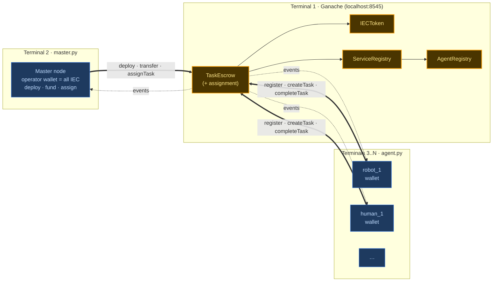
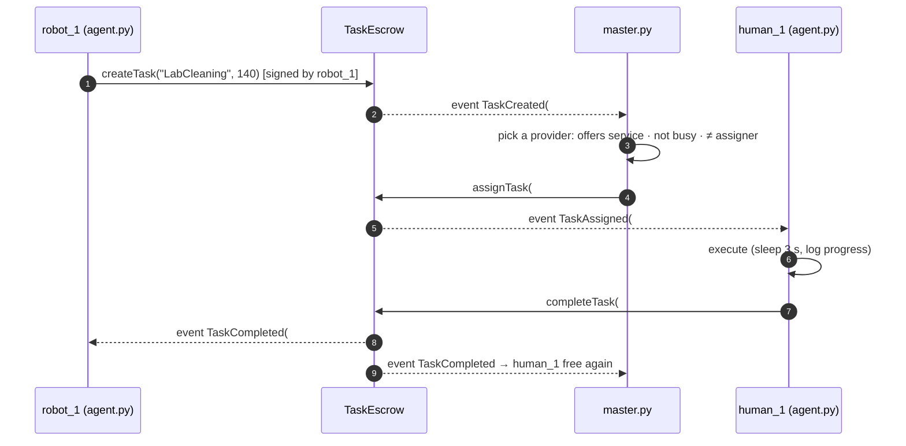

# Blockchain demo — multi-terminal agents on Ganache

A small, standalone demo of the blockchain layer described in
[blockchain-functionalities.md](blockchain-functionalities.md) and
[blockchain-briefing.md](blockchain-briefing.md). It doesn't change the Mesa simulator.
Each agent and the master node runs as its **own Python process in its own terminal**. They
coordinate only through **transactions** and **events** on a local Ganache chain.

> **Update (implemented):** the demo is **fully manual**. Nothing happens automatically:
> the master `deploy`s, `fund`s and `assign`s, and agents `register`, `create`, `complete`
> or `fail`, each by typing a command in its own terminal. The automatic posting,
> assignment, timeouts and timed execution described in §5 below were dropped.
> Commands and demo script: [demo/README.md](../demo/README.md).

---

## 1 · What the demo shows

> Several terminals on one laptop. Each one is an independent robot or human agent with
> its own wallet. Agents post tasks (with the reward locked in escrow), a master node
> assigns each task to an agent that offers that service, the assigned agent executes it
> and marks it completed, and the escrow pays the worker. Every step is a real
> transaction on a local Ethereum chain, and every terminal reacts to the chain's events
> and logs them.

What the audience sees:

```
┌ ganache ───────────┐ ┌ master ────────────────────────┐ ┌ robot_1 ─────────────────────┐
│ eth_sendRawTx ...  │ │ [deploy] IECToken 0x5b…         │ │ [init] registered as robot   │
│ Block #12 mined    │ │ [fund]   robot_1 ← 2000 IEC     │ │ [task] created #3 LabCleaning│
│ ...                │ │ [event]  TaskCreated #3 by r1   │ │        reward 140 locked     │
│                    │ │ [assign] #3 → human_1           │ │ [event] #3 completed by h1 ✓ │
└────────────────────┘ └─────────────────────────────────┘ └──────────────────────────────┘
┌ human_1 ─────────────────────┐ ┌ robot_2 ──────┐ ┌ human_2 ──────┐
│ [event] assigned #3 to me    │ │ ...           │ │ ...           │
│ [exec]  LabCleaning 3s ...   │ │               │ │               │
│ [tx]    completeTask(#3) ✓   │ │               │ │               │
│ [bal]   2140 IEC             │ │               │ │               │
└──────────────────────────────┘ └───────────────┘ └───────────────┘
```

### Requirements → where they are covered

| Requirement | Covered by |
| --- | --- |
| Create the smart contracts (4 + assignment) | `IECToken`, `AgentRegistry`, `ServiceRegistry`, `TaskEscrow`. Assignment is `TaskEscrow.assignTask`, called by the master (see §3, decision Q1) |
| Run Ganache and deploy the contracts | Terminal 1 runs Ganache. The master deploys the 4 contracts at startup and writes their addresses + ABIs to `deployments.json` |
| Python scripts as agents and master | `master.py` (one process) and `agent.py --name robot_1` (one process per agent) |
| Initialize everything and log it all in the terminals | Master: deploy → create wallets → fund. Agent: register → approve escrow → register services. Each action and event gets a coloured, prefixed log line |
| Agents listen to events | Each process polls event filters (`TaskCreated`, `TaskAssigned`, `TaskCompleted`, …) and reacts |
| Agents talk to the contracts through transactions | agent logic → `ChainClient.send_tx()` → signed with the agent's own key → contract function. No shared memory, files or sockets between agents |
| Agents create, execute and complete tasks | `createTask` (locks reward) → master `assignTask` → assignee "executes" (timed sleep) → assignee `completeTask` (reward paid) |
| Master wallet holds all the money | `IECToken` mints the whole supply to the master at deploy time. The master sends each agent its starting IEC and some test ETH for gas |

---

## 2 · Architecture



**Rule:** processes never talk to each other directly. The chain is the only channel. A
transaction is how an agent *acts*, and an event is how the others *find out*.

### One task, end to end



---

## 3 · Open decisions (recommendation first)

| # | Question | Recommendation | Alternative |
| --- | --- | --- | --- |
| Q1 | "4 + assignation": is assignment its own contract? | Keep the 4 contracts. **Assignment = `TaskEscrow.assignTask`**, and the master decides who gets the task off-chain. This matches D4 in the functionalities doc, and the same contracts carry straight over to the simulator | A 5th `TaskAssignment` contract that picks the provider on-chain (for example, first registered free provider). More on-chain logic, but the chain can't know who is "busy" or "idle" without extra transactions |
| Q2 | Who marks a task completed? | **The assignee** calls `completeTask` / `failTask` (you said "agents… mark it as completed"). The master can also do it, which covers timeouts | Master-only completion as in D3 (the simulator is the oracle). Simpler trust model, but agents don't really "complete" anything themselves |
| Q3 | Where does the money start? | `IECToken` constructor mints the **total supply to the master**. The master `transfer`s `initial_wealth` to each agent. Supply is fixed from the start, so no `finishMinting` is needed | Mint per agent, then `finishMinting` (as in the functionalities doc) |
| Q4 | Agent wallets | Deterministic keys from `seed + agent name`, starting with 0 ETH / 0 IEC, so it's visible that the master funds them | Use Ganache's pre-funded accounts 1..N. Fewer steps, but every agent already starts "rich" in ETH |
| Q5 | Repo | **Same repo, separate `demo/` folder, on a branch** (see §6) | New repo |

---

## 4 · Folder layout

```
demo/
├── README.md               how to run the demo
├── package.json            ganache, @openzeppelin/contracts
├── requirements.txt        web3, py-solc-x, pyyaml, colorama
├── demo_config.yaml        agents, services, wealth, timings, ports
├── contracts/
│   ├── IECToken.sol
│   ├── AgentRegistry.sol
│   ├── ServiceRegistry.sol
│   └── TaskEscrow.sol
├── chain/
│   ├── client.py           ChainClient: connect, load deployments, send_tx, call, event polling
│   ├── compile.py          py-solc-x compile (evm_version pinned, see §7)
│   ├── wallets.py          deterministic key derivation
│   └── log.py              coloured, prefixed per-node logger
├── master.py
├── agent.py
├── start-demo.sh           opens all terminals as tmux panes (WSL)
└── out/                    (gitignored) deployments.json, logs/*.log
```

### `demo_config.yaml` (sketch)

```yaml
chain:
  rpc: http://127.0.0.1:8545
  seed: 32
  gas_eth_per_agent: 10
token:
  total_supply: 100000        # all minted to the master
agents:
  robot_1: { kind: robot, initial_wealth: 2000, services: { LabCleaning: 0.95, ItemTransport: 0.95, SurveillancePatrol: 0.9 } }
  robot_2: { kind: robot, initial_wealth: 2000, services: { LabCleaning: 0.95, ComponentRestock: 0.9 } }
  human_1: { kind: human, initial_wealth: 2000, services: { BatteryCharging: 0.95, LabCleaning: 0.95, SystemUpdate: 0.95 } }
  human_2: { kind: human, initial_wealth: 2000, services: { BatteryCharging: 0.95, PowerSupply: 0.95, FunctionalityTest: 0.95 } }
services:                     # reward range and execution time per service
  LabCleaning:     { reward: [100, 180], duration_s: 4 }
  BatteryCharging: { reward: [80, 140],  duration_s: 3 }
  # ...
behaviour:
  create_task_every_s: [5, 12]  # each agent posts a task at a random interval
  poll_interval_s: 0.5
```

---

## 5 · Implementation plan

### Phase 0 · Environment (½ day)
- Install Node.js LTS, then `npm install` in `demo/` (Ganache + OpenZeppelin as local deps,
  run with `npx ganache`).
- Python venv for the demo: `pip install -r demo/requirements.txt`.
- **Done when:** `npx ganache --wallet.deterministic` runs and `web3` in Python connects
  and prints account 0.

### Phase 1 · Smart contracts (1–1½ days)
Same functions as in [blockchain-briefing.md](blockchain-briefing.md#smart-contract-functions), with the Q2/Q3 changes:

| Contract | Functions | Events |
| --- | --- | --- |
| `IECToken` (OZ ERC-20, 2 decimals) | constructor mints `total_supply` → master. Standard `transfer`, `approve`, `transferFrom`, `balanceOf` | `Transfer`, `Approval` |
| `AgentRegistry` | `registerAgent(agentId, kind)`, `isRegistered`, `getAgent` | `AgentRegistered` |
| `ServiceRegistry(agentRegistry)` | `registerService(name, category, skill)`, `offers(provider, name)`, `getProviders(name)` | `ServiceRegistered` |
| `TaskEscrow(token, agentReg, serviceReg, operator)` | `createTask(service, reward)`, `assignTask(id, assignee)` *onlyOperator*, `completeTask(id)` / `failTask(id)` *assignee or operator*, `requeueTask(id)` *operator*, `cancelTask(id)` *assigner*, `getTask`, `totalLocked` | `TaskCreated`, `TaskAssigned`, `TaskCompleted`, `TaskFailed`, `TaskRequeued`, `TaskCancelled` |

- Reverts with clear messages (`"not registered"`, `"insufficient balance"`,
  `"assignee does not offer service"`, `"wrong status"`, `"not assignee"`) so the logs read
  well.
- **Done when:** `chain/compile.py` compiles all 4, and a throwaway script deploys them and
  runs one task through the happy path plus one revert.

### Phase 2 · Chain client (1 day)
`chain/client.py`, the only module that imports `web3`:
- `connect(rpc)`, `load_deployments()` (waits until `out/deployments.json` exists)
- `send_tx(wallet, contract, fn, *args)` → build, sign, send, wait for receipt, log
  `tx hash · block · gas`. A revert raises `TxReverted(reason)`.
- `call(contract, fn, *args)` for read-only views
- `subscribe(contract, event, handler, filter=...)` → registers an event filter.
  `run_forever()` polls every `poll_interval_s` and dispatches to the handlers.
- Each process signs with **its own key only**, so there are no nonce collisions between
  terminals.

### Phase 3 · Master node (1 day)
`master.py`:
1. **Init:** connect → use Ganache account 0 as master/operator → compile and deploy
   Token → AgentRegistry → ServiceRegistry → TaskEscrow → write `out/deployments.json`
   (addresses + ABIs).
2. **Fund:** for each agent in the config, derive its address, send `gas_eth_per_agent`
   ETH, then `transfer(initial_wealth)` IEC. Log the master's balance going down.
3. **Listen and assign:**
   - `TaskCreated` → add to the pending queue
   - for each pending task: `getProviders(service)` → filter out the assigner and busy
     agents → pick one at random → `assignTask`. If nobody is free, retry later.
   - `TaskAssigned` → mark the agent busy. `TaskCompleted` / `TaskFailed` → mark it free.
   - Optional: if an agent hasn't completed within N × duration, `requeueTask` (timeout).
4. **Status line** every ~10 s: balances of everyone + escrow locked + total
   (the total must always equal `total_supply`, which shows conservation of money).

### Phase 4 · Agent node (1 day)
`agent.py --name robot_1`:
1. **Init:** derive its wallet → wait for `deployments.json` and for the master's ETH/IEC
   to arrive → `registerAgent` → `approve(TaskEscrow, max)` → `registerService` ×N.
2. **Listen:**
   - `TaskAssigned(assignee == me)` → log, "execute" (sleep `duration_s` with a progress
     line), roll success with `skill` → `completeTask` or `failTask`.
   - `TaskCompleted` / `TaskFailed` where I'm the assigner → log the outcome.
   - `Transfer` to or from me → log the new balance.
3. **Act:** at a random interval, pick a service it does **not** offer, sample a reward →
   `createTask`. If it reverts (`insufficient balance`), log it and carry on.

### Phase 5 · Logging and launcher (½ day)
- `chain/log.py`: one colour per node, prefix `[HH:MM:SS][robot_1][tx]`. Lines are mirrored
  to `out/logs/<node>.log`.
- `start-demo.sh`: opens a tmux session with one pane per node
  (`tmux split-window ...`): Ganache → master (waits for RPC) → each agent.
- `stop`: closing Ganache wipes the chain, since there's a fresh chain every run.

### Phase 6 · Demo script and rehearsal (½ day)
A ~5-minute script in `demo/README.md`:
1. Start Ganache: empty chain.
2. Start the master: 4 deploys, then funding. The master's balance drops from 100 000.
3. Start the agents one by one: registrations show up in the master's log.
4. Let it run: tasks created → assigned → executed → paid, across terminals.
5. Show a **revert**: an agent with low funds tries to post an expensive task (a
   `--broke` flag or a low `initial_wealth`).
6. Show **conservation**: master status line, Σ balances + escrow = total supply.
7. Optional: kill one agent mid-task → master timeout → `requeueTask` → reassigned.

**Total: about 5–6 working days.**

---

## 6 · Same repo or new repo?

**Recommendation: same repo, separate top-level `demo/` folder, on a `blockchain-demo`
branch.**

- **No interference:** `demo/` has its own `requirements.txt`, `package.json` and entry
  points. Nothing in `robopreneur/`, `app.py`, `scripts/` or the Dockerfile imports it or
  changes, so the simulator and experiments behave exactly as today.
- **Reuse later:** the contracts and `ChainClient` are the same pieces the full integration
  needs (`robopreneur/blockchain/` in the functionalities doc). When that work starts, they
  move into the package instead of being copied across repos.
- **One place for docs:** the design docs already live in `docs/`.
- Add `demo/out/` and `demo/node_modules/` to `.gitignore`.

A separate repo is only worth it if the demo has to be shared or handed in on its own,
without the simulator code.

---

## 7 · Known gotchas

- **Ganache is sunset** (Consensys, 2023) but still works for this. If it causes trouble,
  **Anvil** (Foundry) is a drop-in replacement on the same port. Only the launcher command
  changes.
- **EVM version:** Ganache v7 supports up to *Shanghai*. solc ≥ 0.8.25 targets *Cancun* by
  default, so compile with `evm_version="shanghai"` (or `paris`). Otherwise deploys fail
  with `invalid opcode`.
- **Ganache needs Node ≤ 20:** on newer Node its native web server (µWS) doesn't load, and
  the fallback server leaks connections and stalls for ~30 s under the demo's load. Fixed
  by a local `node@20` npm dependency that `npm run ganache` picks up.
- **Event polling, not websockets:** each process polls `get_logs` over HTTP from the last
  block it saw and delivers events in chain order. No server-side filters can expire.
- **Nonces are tracked locally:** Ganache's `pending` transaction count can lag behind.
  Each key is used by exactly one process, so the client counts its own nonces.
- **On Windows the venv's `python.exe` is a launcher** that starts the real interpreter
  as a child. When you stop processes from a script, kill by command line
  (`agent.py` / `master.py`), not by the launcher's path.
- **Startup order:** agents must wait for `deployments.json` **and** for their ETH funding
  before sending anything, or `registerAgent` fails for lack of gas.
- **Keys:** derived keys are for the local demo only. Never reuse them on a real network.
