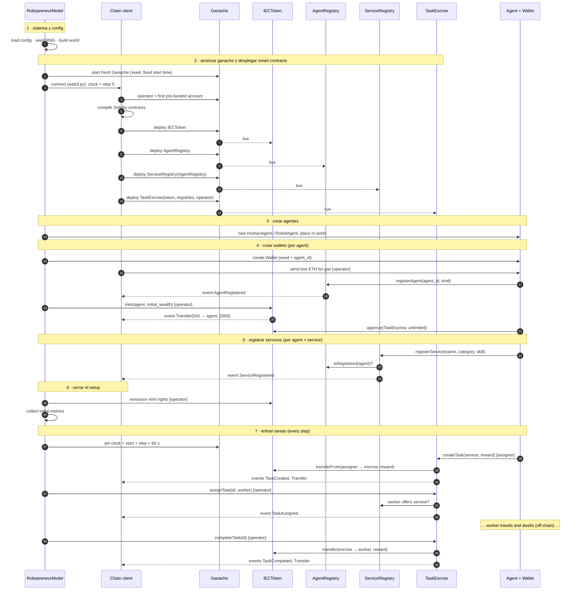

# Simulator flow

| # | Phase | Where in the code | Runs when |
| --- | --- | --- | --- |
| 1 | **Sistema y config** | `core/model.py` `__init__` | once |
| 2 | **Arrancar Ganache y desplegar smart contracts** (deploy) | `blockchain/ganache.py` + `blockchain/chain.py` ← *moved up* | once |
| 3 | **Crear agentes** | `RobopreneurModel.initialize_agents()` | once |
| 4 | **Crear wallets** (+ gas ETH, + register agent, + fund) | `behaviour/agents.py` + `blockchain/wallet.py` | once |
| 5 | **Registrar servicios** | `behaviour/agents.py` → ServiceRegistry | once |
| 6 | **Cerrar el setup** + first metrics | `core/model.py` | once |
| 7 | **Entran tareas de cada agente con su wallet** | `model.step()` loop | every step |

All startup transactions (phases 2–6) happen at **step 0** of the chain clock.

## Flow chart 

```mermaid
flowchart TD

  classDef init     fill:#1e3a5f,stroke:#3b82f6,color:#bfdbfe
  classDef chain    fill:#3d3000,stroke:#facc15,color:#fef08a,stroke-width:2px
  classDef contract fill:#4a3500,stroke:#f59e0b,color:#fde68a,stroke-width:2px
  classDef agent    fill:#3f2c1c,stroke:#fb923c,color:#fed7aa
  classDef loop     fill:#1a2e1a,stroke:#22c55e,color:#bbf7d0

  %% ═══════════════════════════════════════════════════════════════
  subgraph P1["1 · sistema y config  —  core/model.py"]
    direction TB
    S1([load config.yaml]):::init
    S2[read sections\nsimulation · world · humans · robots\nbattery · tasks · services · blockchain]:::init
    S3[seed random generator\nnp.random.default_rng seed]:::init
    S4[build world\nsquare space or floor plan]:::init
    S5[create datacollector\ntask_queue · counters]:::init
    S1 --> S2 --> S3 --> S4 --> S5
  end

  %% ═══════════════════════════════════════════════════════════════
  subgraph P2["2 · arrancar ganache y desplegar smart contracts  —  blockchain/"]
    direction TB
    C1[start a fresh Ganache\n--wallet.seed = sim seed\n--chain.time = fixed start]:::chain
    C2[connect with web3.py\nset chain clock to step 0]:::chain
    C3[operator wallet\n= Ganache's first pre-funded account]:::chain
    C3b[compile Solidity contracts\npy-solc-x]:::chain
    C4[deploy IECToken\nowner = operator]:::contract
    C5[deploy AgentRegistry]:::contract
    C6[deploy ServiceRegistry\nknows AgentRegistry]:::contract
    C7[deploy TaskEscrow\nknows token · both registries · operator]:::contract
    C1 --> C2 --> C3 --> C3b --> C4 --> C5 --> C6 --> C7
  end

  %% ═══════════════════════════════════════════════════════════════
  subgraph P3["3 · crear agentes  —  initialize_agents"]
    direction TB
    A1[for each human type × num\nHumanAgent  e.g. human_1_0]:::agent
    A2[for each robot type × num\nRobotAgent  e.g. robot_1_0]:::agent
    A3[build Service objects\nfrom each agent's services list]:::agent
    A4[place at random position]:::agent
    A1 --> A3
    A2 --> A3
    A3 --> A4
  end

  %% ═══════════════════════════════════════════════════════════════
  subgraph P4["4 · crear wallets  —  per agent"]
    direction TB
    W1[4a · create Wallet\nkey derived from seed + agent_id]:::chain
    W1b[4b · send test ETH for gas\nsigned by operator]:::chain
    W2[4c · registerAgent\nsigned by agent wallet]:::contract
    W3[4d · mint initial_wealth IEC\nsigned by operator]:::contract
    W4[4e · approve TaskEscrow\nsigned by agent wallet]:::contract
    W1 --> W1b --> W2 --> W3 --> W4
  end

  %% ═══════════════════════════════════════════════════════════════
  subgraph P5["5 · registrar servicios  —  per agent × service"]
    direction TB
    R1[registerService\nname · category · skill × 1000\nsigned by agent wallet]:::contract
  end

  %% ═══════════════════════════════════════════════════════════════
  subgraph P6["6 · cerrar el setup"]
    direction TB
    G1[operator gives up mint rights\ntotal supply is now fixed]:::contract
    G3[collect initial metrics\nrunning = true]:::init
    G1 --> G3
  end

  %% ═══════════════════════════════════════════════════════════════
  subgraph P7["7 · entran tareas  —  model.step every step"]
    direction TB
    L0[set chain clock\n= start + step × 60 s]:::chain
    L1[generate_tasks\nassigner wallet → createTask\nreward locked in escrow]:::loop
    L2[agents step\nrecharge → createTask\nfinish → completeTask / failTask\ninterrupt → requeueTask]:::loop
    L3[assign_tasks\noperator → assignTask]:::loop
    L4[collect metrics]:::loop
    L0 --> L1 --> L2 --> L3 --> L4
    L4 -->|next step| L0
  end

  S5 --> C1
  C7 --> A1
  C7 --> A2
  A4 --> W1
  W4 --> R1
  R1 --> G1
  G3 --> L0
```



---

## 2 · Phase by phase

### Phase 1 · Sistema y config

Same as today (`core/model.py` lines 11–69), plus reading one new config section:

```yaml
blockchain:
  ganache_cmd: ganache      # command used to start Ganache (Node.js package)
  port: 8545
  gas_eth_per_agent: 10     # test ETH each agent wallet receives for gas
```

| Step | What | Why |
| --- | --- | --- |
| load config | `config.yaml` → dict | single source of truth for everything |
| seed RNG | `np.random.default_rng(seed)` | same seed → same run. **Also used to start Ganache and create wallets** (phases 2 and 4), so accounts and addresses are reproducible too |
| build world | square or floor plan | agents need somewhere to be placed |
| datacollector, `task_queue`, counters | empty containers | ready to be filled |

---

### Phase 2 · Arrancar Ganache y desplegar smart contracts

**Ganache** is an Ethereum blockchain that runs on your own computer. **"Deploy"** = install
a program on that blockchain. After it's deployed it has its own address, and its rules
can't be changed.

| Order | What | Why this order |
| --- | --- | --- |
| 2a | **start a fresh Ganache** (`--wallet.seed`, `--chain.time`) | the "ground" everything else is built on. Fresh per run → no leftovers from previous runs; seeded → same accounts every run |
| 2b | **connect with `web3.py`**, set the clock to step 0 | the chain client (`chain.py`) is the only module that talks to Ganache |
| 2c | **operator wallet** = Ganache's first account | someone must deploy the contracts and later report task outcomes (the oracle, D3). That's the simulator itself. Ganache pre-loads this account with test ETH to pay gas |
| 2d | **compile** the Solidity contracts (`py-solc-x`) | Ganache runs bytecode, not Solidity source |
| 2e | **IECToken** | no dependencies — it's just the currency |
| 2f | **AgentRegistry** | no dependencies — the member list |
| 2g | **ServiceRegistry** | needs AgentRegistry, to refuse services from non-members |
| 2h | **TaskEscrow** | needs everything: the token (to hold money), both registries (to check assignees), and the operator address (who may complete/fail tasks) |

> **Why this exact order?** A contract that checks another contract must be told *where*
> that contract lives when it is deployed. So dependencies go first — like building
> foundations before walls before the roof.

> **Blocks on Ganache:** Ganache mines every transaction instantly into its own block, so
> each deploy is its own block. What ties transactions to the simulation is the **clock**:
> everything in phases 2–6 is stamped with step 0.

---

### Phase 3 · Crear agentes

Exactly as today (`initialize_agents`): one `HumanAgent` / `RobotAgent` per `num` in each
type, with their `Service` objects built from the config, placed at a random position.

Nothing on-chain happens here. The agents exist as Python objects but **have no money and
no identity on the market yet**.

> **Why keep agent creation separate from wallets?** The agent is the physical
> robot/human (position, battery, speed). The wallet is its bank account. Keeping them
> separate keeps `agents.py` focused on behaviour, while all key and money logic lives in
> `blockchain/` — one place to read and test.

---

### Phase 4 · Crear wallets

For each agent, five things, in this order:

| Sub-step | Transaction | Signed by | What changes |
| --- | --- | --- | --- |
| **4a · create wallet** | — (no transaction, it's just generating keys) | — | agent gets `wallet.address` and a private key |
| **4b · send test ETH** (`gas_eth_per_agent`) | yes | operator | the agent can now pay gas for its own transactions |
| **4c · registerAgent**(`agent_id`, `kind`) | yes | the agent | AgentRegistry now lists this address as `human` or `robot` |
| **4d · mint**(`address`, `initial_wealth`) | yes | operator | the agent's wallet goes from 0 → 2000 IEC |
| **4e · approve**(TaskEscrow, unlimited) | yes | the agent | the escrow contract is allowed to pull IEC from this wallet when this agent creates a task |

> **Why does the agent need ETH?** On Ethereum (Ganache included) every transaction pays a
> small fee called **gas**, and gas is paid in **ETH**, not in our IEC token. On Ganache ETH
> is free test money, so the operator simply gives each agent enough for the whole run.
> The agent's IEC (its real market money) is never used for fees. Without ETH, step 4c
> would fail — the agent couldn't sign anything.

> **Why is the private key derived from the seed + agent_id?** Real wallets use a truly
> random key. But for experiments we want `robot_1_0` to have **the same address every run
> with the same seed**, so results and logs are comparable. These keys are for simulation
> only — never use them on a real network.

> **Why register before funding?** So that money is only ever minted to market members.
> The token can check the registry and refuse to mint to unknown addresses.

> **What is `approve` and why is it needed?** On a blockchain, a contract **can't take
> money from your wallet on its own** — that would be dangerous. You must first authorize
> it, like setting up a **domiciliación bancaria** (direct debit) with your bank. It's the
> standard rule of ERC-20 tokens. Doing it once at init means each later `createTask` is a
> single transaction instead of two (approve + create).

> **Why is `agent.wealth` still a number the metrics can read?** It becomes a read of the
> wallet balance (`IECToken.balanceOf(address)`), so `metrics.py` keeps working.

---

### Phase 5 · Registrar servicios

For each agent, for each service in its config:

```
registerService(name, category, skill)   signed by the agent's wallet
  e.g. robot_1_0 → registerService("LabCleaning", "cleaning", 950)
```

- The ServiceRegistry checks the sender is a registered agent (that's why phase 4 comes
  first).
- `skill` is stored ×1000 (`0.95 → 950`) because blockchains have no decimals.
- The *definition* of the service (reward median, phases, waypoints) stays in
  `config.yaml` — the registry only says **who offers what**.

> **Why register services before any task exists?** When a task is assigned, the escrow
> checks the assignee actually offers that service. If services weren't registered yet,
> every assignment would be rejected.

---

### Phase 6 · Cerrar el setup

| Step | Why |
| --- | --- |
| **operator gives up mint rights** | After this, nobody can create new IEC. The total money in the system is fixed (in the default config: 4 agents × 2000 = **8000 IEC**). This guarantees the economy can't be inflated mid-run, and lets us check that money is conserved. |
| **collect initial metrics** | Same as today (`datacollector.collect`), step 0 snapshot. |

> **Note for metrics:** once tasks lock money in escrow, the sum of agent balances drops
> temporarily. `System_Wealth` must be **balances + money locked in escrow**, otherwise it
> looks like money disappears. Gini stays computed on **available balances** (money an
> agent can actually spend right now).

---

### Phase 7 · Entran tareas de cada agente con su wallet

This is the normal step loop. Inside it, the smart contracts do their real work. Each
transaction is mined instantly (its own block), and the simulator gets the result back
before moving on:

| Step-loop moment | Who | Transaction | Contract effect |
| --- | --- | --- | --- |
| start of step | operator | — (`evm_setTime`) | Ganache clock = `start + step × 60 s`, so every transaction below is stamped with this step |
| `generate_tasks()` | random **assigner** agent | `createTask(service, reward)` | reward moves **wallet → escrow**. If not enough IEC → reverts → task is **not** posted, `Rejected_Tasks += 1` |
| robot `update_battery()` hits threshold | the **robot** | `createTask(BatteryCharging, reward)` | same; if it reverts the robot is **stranded** and retries after `recharge_max_wait` steps (D7) |
| `assign_tasks()` | operator | `assignTask(id, assignee)` | checks assignee is registered and offers that service |
| task interrupted (schedule / low battery) | operator | `requeueTask(id)` | back to `Open`, money stays locked |
| `_finish_task(success=True)` → `economy.settle_task` | operator | `completeTask(id)` | **escrow → worker** |
| `_finish_task(success=False)` → `economy.settle_task` | operator | `failTask(id)` | **escrow → assigner** (refund) |
| `datacollector.collect()` | — | — (read only) | balances, escrow total, tx count, gas |

---

## 3 · Sequence — who talks to whom



---

## 4 · State right after initialization (default `config.yaml`)

Default config: 2 humans (6 services each), 2 robots (4 services each), 2000 IEC each.

**Balances**

| Agent | Kind | IEC balance | Test ETH (gas) | Allowance to TaskEscrow |
| --- | --- | --- | --- | --- |
| `human_1_0` | human | 2000 IEC | ~10 ETH | unlimited |
| `human_2_0` | human | 2000 IEC | ~10 ETH | unlimited |
| `robot_1_0` | robot | 2000 IEC | ~10 ETH | unlimited |
| `robot_2_0` | robot | 2000 IEC | ~10 ETH | unlimited |
| TaskEscrow | contract | 0 IEC | — | — |
| **Total supply** | | **8000 IEC (fixed)** | | |

(ETH is "~10" because the agent has already spent a little on gas for its own setup
transactions.)

**ServiceRegistry — who offers what**

| Service | Providers |
| --- | --- |
| BatteryCharging | human_1_0, human_2_0 |
| LabCleaning | human_1_0, human_2_0, robot_1_0, robot_2_0 |
| ItemTransport | human_1_0, human_2_0, robot_1_0, robot_2_0 |
| PowerSupply | human_1_0, human_2_0 |
| SystemUpdate | human_1_0, human_2_0 |
| FunctionalityTest | human_1_0, human_2_0 |
| SurveillancePatrol | robot_1_0, robot_2_0 |
| ComponentRestock | robot_1_0, robot_2_0 |

**Setup transactions (all at step 0) — 41 transactions, one block each**

| Transaction | Count |
| --- | --- |
| deploy contracts | 4 |
| send test ETH | 4 |
| registerAgent | 4 |
| mint | 4 |
| approve | 4 |
| registerService | 20 (2 × 6 + 2 × 4) |
| renounce mint | 1 |
| **total** | **41** |

---

## 5 · Mapping to the current code

| Phase | Today | With blockchain |
| --- | --- | --- |
| 1 | `RobopreneurModel.__init__` lines 11–69 | + read `blockchain:` section |
| 2 | — | new `self._init_chain()` called right after phase 1: start Ganache, connect, deploy |
| 3 | `self.initialize_agents()` (line 71) | unchanged |
| 4 | — | new `self._init_wallets()` after `initialize_agents()` |
| 5 | services only built as Python objects in agent `__init__` | new `self._register_services()` |
| 6 | `self.datacollector.collect(self)` (line 73) | + renounce mint before collecting |
| 7 | `model.step()` (line 108) | + set chain clock at the start, `createTask` / `assignTask` / `completeTask` / `failTask` / `requeueTask` calls in the existing functions |
| end | — | stop the Ganache process when the run finishes |
